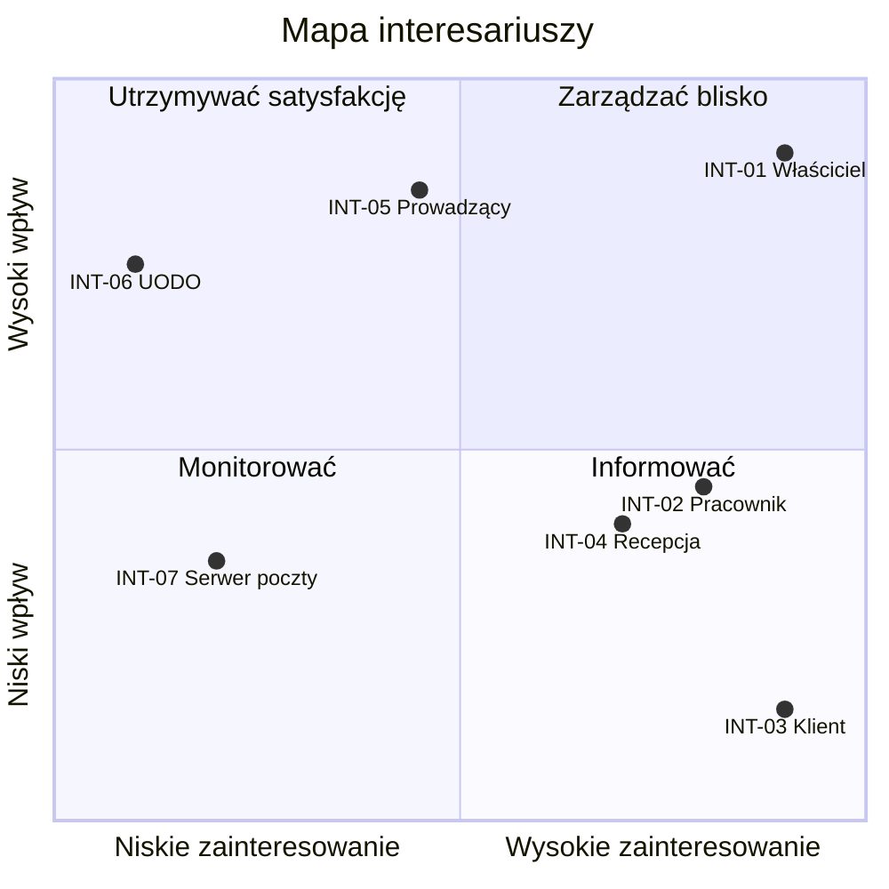

# 01. Wizja i zakres systemu

## 1.1. Opis problemu

| | |
|---|---|
| **Problem** | Zapisy na wizyty przyjmowane są telefonicznie i w wiadomościach, a grafik pracowników prowadzony jest w kalendarzu papierowym albo arkuszu kalkulacyjnym. |
| **dotyczy** | małych usługodawców pracujących na wizyty (gabinety, salony, konsultanci) z obsadą od jednej do kilku osób oraz ich klientów |
| **skutkiem jest** | przerywanie pracy telefonami, możliwość zapisu wyłącznie w godzinach otwarcia, dwie rezerwacje na ten sam termin, nieobecności klientów, którzy zapomnieli o wizycie, oraz brak wiarygodnej historii zapisów |
| **dobre rozwiązanie** | klient rezerwuje sam, o dowolnej porze, widząc wyłącznie terminy faktycznie wolne; system pilnuje kolizji, potwierdza rezerwację i przypomina o wizycie e-mailem, a usługodawca prowadzi jeden grafik dla całego zespołu |

## 1.2. Cel biznesowy i mierniki sukcesu

<!-- Cele mierzalne (SMART), np. „skrócenie czasu obsługi rezerwacji z 10 do 3 minut”.
Wartości docelowe i dane bazowe (obecny odsetek nieobecności, liczba telefonów dziennie) wymagają potwierdzenia w wywiadzie z klientem na zajęciach 2. -->

| ID     | Cel                                                          | Miernik                                                                            | Wartość docelowa                                       |
| ------ | ------------------------------------------------------------ | ---------------------------------------------------------------------------------- | ------------------------------------------------------ |
| CEL-01 | Przeniesienie zapisów z rozmów telefonicznych do samoobsługi | udział rezerwacji założonych samodzielnie przez klienta we wszystkich rezerwacjach | ≥ 70% w trzecim miesiącu po wdrożeniu                  |
| CEL-02 | Skrócenie czasu potrzebnego na zapisanie się na wizytę       | mediana czasu od otwarcia strony rezerwacji do potwierdzenia rezerwacji            | ≤ 2 minuty                                             |
| CEL-03 | Wyeliminowanie dwóch rezerwacji na ten sam termin            | liczba kolizji terminów zgłoszonych w kwartale                                     | 0                                                      |
| CEL-04 | Ograniczenie nieobecności klientów na wizytach               | udział wizyt niezrealizowanych bez wcześniejszego anulowania                       | ≤ 10% (przy przypomnieniu wysyłanym 24 h przed wizytą) |
| CEL-05 | Umożliwienie zapisu poza godzinami pracy usługodawcy         | udział rezerwacji złożonych poza godzinami otwarcia                                | ≥ 30%                                                  |

## 1.3. Interesariusze

| ID | Interesariusz | Opis / rola | Oczekiwania wobec systemu | Wpływ (W/Ś/N) | Zainteresowanie (W/Ś/N) |
|---|---|---|---|---|---|
| INT-01 | Właściciel firmy usługowej | Prowadzi firmę usługodawcy (gabinet, salon, konsultant), zatrudnia od jednej do kilku osób, sam też często wykonuje usługi; decyduje o zakupie systemu i za niego płaci | Mniej telefonów przerywających pracę, jeden grafik całego zespołu zamiast zeszytu, brak dwóch rezerwacji na ten sam termin, mniej nieobecności klientów, pełna kontrola nad katalogiem usług, grafikami i regułą anulowania | W | W |
| INT-02 | Pracownik wykonujący usługi | Fryzjer, kosmetyczka lub inny specjalista, który przyjmuje klientów według własnego grafiku | Aktualny podgląd swoich rezerwacji na dziś i najbliższe dni, widoczne w grafiku nowe i anulowane rezerwacje bez dopytywania właściciela, rezerwacje wyłącznie w godzinach jego pracy i z przerwą między wizytami | Ś | W |
| INT-03 | Klient | Osoba, która umawia się na usługę, zwykle co kilka tygodni | Zapis o dowolnej porze bez dzwonienia i bez zakładania konta, widoczne tylko naprawdę wolne terminy, potwierdzenie i przypomnienie e-mailem, możliwość samodzielnego anulowania rezerwacji | N | W |
| INT-04 | Osoba na recepcji | W firmach z recepcją odbiera telefony od klientów; w mniejszych firmach tę pracę wykonuje właściciel | Szybkie sprawdzenie wolnych terminów w kalendarzu rezerwacji podczas rozmowy telefonicznej, podgląd kartoteki klientów, mniej telefonów dzięki publicznej stronie rezerwacji | Ś | W |
| INT-05 | Prowadzący zajęcia (zamawiający system) | Na zajęciach 2 występuje w roli klienta zamawiającego system; ocenia dokumentację i akceptuje zakres | Dokumentacja kompletna i spójna, na podstawie której zespół w cz. 2 zaimplementuje system bez zgadywania; zakres MVP możliwy do zrealizowania w jeden semestr | W | Ś |
| INT-06 | Prezes Urzędu Ochrony Danych Osobowych (UODO) | Organ nadzorczy, który kontroluje przetwarzanie danych osobowych klientów (imię, nazwisko, e-mail, telefon, historia rezerwacji) i pracowników (dane kont, grafiki) | Przetwarzanie danych zgodne z RODO: zgoda na przetwarzanie, zbieranie tylko niezbędnych danych, określony okres przechowywania, możliwość usunięcia danych klienta na jego żądanie | W | N |
| INT-07 | Dostawca serwera poczty elektronicznej | Zewnętrzna usługa pocztowa (sekcja 1.6.1), przez którą system wysyła potwierdzenia, przypomnienia i informacje o anulowaniu | Wysyłka zgodna z regulaminem i limitami usługi, poprawnie skonfigurowane dane dostępowe, brak wiadomości oznaczanych jako spam | Ś | N |

Interesariusze INT-05, INT-06 i INT-07 nie korzystają z systemu bezpośrednio. Pozostali są użytkownikami opisanymi w sekcji 1.4.

### Mapa interesariuszy

| Strategia | Interesariusze | Co to oznacza w projekcie |
|---|---|---|
| Zarządzać blisko | INT-01 | Konsultujemy z nim każdą decyzję o zakresie i regułach rezerwacji (wywiad na zajęciach 2). |
| Utrzymywać satysfakcję | INT-05, INT-06 | Dokumentacja zgodna z wymaganiami przedmiotu; wymagania RODO opisane w `08_bezpieczenstwo`. |
| Informować | INT-02, INT-03, INT-04 | Ich potrzeby zbieramy przez właściciela, a w cz. 2 sprawdzamy w testach akceptacyjnych. |
| Monitorować | INT-07 | Sprawdzamy limity i warunki darmowego planu przy wyborze usługi; awaria serwera nie blokuje rezerwacji (sekcja 1.6.1, dziennik decyzji z 2026-11-04). |

## 1.4. Użytkownicy systemu (aktorzy)

| Aktor | Kim jest | Jak często korzysta | Kompetencje cyfrowe |
|---|---|---|---|
| Klient | Osoba umawiająca się na usługę (INT-03). Nie ma konta: rezerwuje na publicznej stronie rezerwacji, a anuluje linkiem z wiadomości e-mail. | Rzadko: raz na kilka tygodni, przy każdej kolejnej wizycie; za każdym razem kilka minut. | Zróżnicowane, od niskich do wysokich. Korzysta głównie z telefonu, często bez wcześniejszej znajomości strony, więc ścieżka rezerwacji musi być prosta i nie może wymagać instrukcji. |
| Pracownik | Specjalista wykonujący usługi (INT-02). Loguje się do systemu i widzi swój grafik oraz swoje rezerwacje. | Codziennie, kilka razy dziennie i na krótko: przed rozpoczęciem pracy i między wizytami. | Średnie. Korzysta z telefonu lub komputera w miejscu pracy; potrzebuje czytelnego widoku dnia, a nie rozbudowanych funkcji. |
| Administrator | Właściciel firmy usługowej (INT-01) albo osoba na recepcji (INT-04), której właściciel nadał tę rolę. Zarządza katalogiem usług, pracownikami, grafikami, kartoteką klientów, rezerwacjami i konfiguracją systemu. | Codziennie, wielokrotnie w ciągu dnia pracy; konfigurację zmienia rzadko (przy zmianie usług, cennika lub grafików). | Średnie do dobrych. Pracuje głównie na komputerze; zna arkusze kalkulacyjne i kalendarze internetowe, ale nie jest informatykiem. |

W MVP osoba na recepcji nie ma osobnej roli w systemie i korzysta z roli Administrator. Czy recepcja powinna mieć węższe uprawnienia niż właściciel, ustalimy w wywiadzie z klientem.

## 1.5. Zakres systemu

### W zakresie (MVP - realizacja w cz. 2)

- **Katalog usług** - nazwa, opis, czas trwania, cena, wskazanie pracowników, którzy wykonują daną usługę.
- **Pracownicy i grafik dostępności** - godziny pracy w tygodniu, wyjątki jednorazowe dla wybranej daty, dni wolne.
- **Publiczna strona rezerwacji** - wybór usługi, pracownika i wolnego terminu, formularz danych klienta ze zgodą na przetwarzanie danych.
- **Wyznaczanie wolnych terminów** - na podstawie grafiku pracownika, czasu trwania usługi, czasu buforowego i istniejących rezerwacji.
- **Rezerwacja i jej cykl życia** - statusy potwierdzona, zrealizowana, anulowana; zabezpieczenie przed dwiema rezerwacjami na ten sam termin.
- **Anulowanie przez klienta** - linkiem z jednorazowym tokenem, bez zakładania konta, w granicach reguły czasowej ustalonej przez usługodawcę.
- **Powiadomienia e-mail** - potwierdzenie rezerwacji, przypomnienie przed wizytą, informacja o anulowaniu; treści ze szablonów z miejscami na dane.
- **Panel administracyjny** - kalendarz rezerwacji, kartoteka klientów, zarządzanie usługami, pracownikami i grafikami, konfiguracja systemu (strefa czasowa, długość kroku terminu, czas buforowy, horyzont rezerwacji, reguła anulowania).
- **Konta i role** - administrator i pracownik: logowanie, zmiana i reset hasła. Klient rezerwuje bez konta.

### Poza zakresem (świadomie wyłączone)

- **Obsługa wielu niezależnych usługodawców w jednej instancji** - panel operatora i izolacja danych między usługodawcami to zakres osobnego projektu.
- **Personalizacja wyglądu pod markę usługodawcy** (kolory, logo, czcionki) - nie wpływa na żaden z celów CEL-01…CEL-05.
- **Widget do osadzania na obcej stronie** - tę samą potrzebę zaspokaja publiczna strona rezerwacji w ramach aplikacji.
- **Powiadomienia SMS** - wymagają płatnej usługi zewnętrznej; e-mail wystarcza do realizacji CEL-04.
- **Synchronizacja z zewnętrznym kalendarzem** (np. Google Calendar).
- **Wiele lokalizacji jednego usługodawcy.**
- **Usługi zdalne z linkiem do spotkania online.**
- **Płatności i zadatki online.**
- **Rezerwacje cykliczne i pakiety wizyt.**
- **Lista rezerwowa na zajęty termin.**
- **Konto klienta z historią wizyt** - dane klienta prowadzi usługodawca w kartotece.
- **Aplikacja mobilna** - strona rezerwacji działa responsywnie w przeglądarce.

### Możliwe rozszerzenia (po MVP)

Kolejność wynika z wpływu na cele biznesowe:

1. Konto klienta z historią wizyt i samoobsługową zmianą terminu.
2. Obsługa wielu usługodawców w jednej instancji wraz z personalizacją wyglądu.
3. Powiadomienia SMS jako kanał uzupełniający przypomnienia.
4. Synchronizacja grafiku z zewnętrznym kalendarzem pracownika.
5. Widget do osadzania na stronie usługodawcy.
6. Płatności i zadatki online, lista rezerwowa, rezerwacje cykliczne.
7. Rezerwacja kilku usług w ramach jednej wizyty (wniosek z analizy Booksy w 1.8).

## 1.6. Kontekst i systemy zewnętrzne

### 1.6.1. Serwer poczty elektronicznej

**Cel wykorzystania:**  
System rezerwacji korzysta z zewnętrznego serwera poczty elektronicznej, aby wysyłać klientom wiadomości dotyczące ich wizyt.

**Zakres współpracy:**
- wysyłanie potwierdzenia rezerwacji;
- wysyłanie przypomnienia o zbliżającej się wizycie;
- wysyłanie informacji o anulowaniu rezerwacji.

**Przekazywane dane:**
- adres e-mail klienta;
- imię klienta, jeśli jest wykorzystywane w treści wiadomości;
- data i godzina wizyty;
- nazwa zarezerwowanej usługi;
- imię pracownika, jeśli jest potrzebne w wiadomości;
- informacja o statusie rezerwacji.

System przekazuje tylko dane potrzebne do przygotowania i wysłania wiadomości.

**Co się dzieje, gdy serwer poczty jest niedostępny?**

Niedostępność serwera poczty nie blokuje utworzenia rezerwacji. Rezerwacja zostaje zapisana w systemie, a wiadomość, której nie udało się wysłać, zostaje oznaczona do ponownej wysyłki.

Po przywróceniu dostępności serwera system powinien spróbować wysłać wiadomość ponownie.

Jeśli wysyłka nadal się nie powiedzie, klient może nie otrzymać potwierdzenia lub przypomnienia na czas. Dlatego system powinien zapisywać status wysyłki wiadomości.

**Ograniczenia:**
- wysyłanie wiadomości wymaga dostępności zewnętrznej usługi pocztowej;
- system nie może zagwarantować, że wiadomość dotrze do skrzynki odbiorczej klienta;
- do konfiguracji poczty potrzebne są odpowiednie dane dostępowe.

**Decyzja:**  
Awaria serwera poczty nie powoduje utraty rezerwacji. System zapisuje rezerwację i umożliwia ponowną próbę wysłania wiadomości po przywróceniu dostępności usługi pocztowej.

## 1.7. Założenia i ograniczenia

| Typ | Opis |
|---|---|
| Założenie | Klienci mają dostęp do urządzenia z przeglądarką internetową i potrafią samodzielnie wypełnić krótki formularz rezerwacji bez zakładania konta. |
| Założenie | Usługodawca ma stały dostęp do Internetu, dzięki czemu może korzystać z panelu administracyjnego i zarządzać rezerwacjami oraz grafikami pracowników. |
| Założenie | Usługodawca posiada adres e-mail, który może zostać wykorzystany do konfiguracji wysyłki wiadomości systemowych. |
| Założenie | Usługodawca przekaże dane początkowe, takie jak lista usług, czas ich trwania, ceny, lista pracowników i ich godziny pracy, a następnie będzie odpowiadać za ich aktualizację. |
| Ograniczenie | Projekt musi zostać zrealizowany w ciągu jednego semestru, równolegle z innymi zajęciami zespołu, co ogranicza zakres MVP do funkcji wymienionych w sekcji 1.5. |
| Ograniczenie | Projekt realizuje trzyosobowy zespół bez komercyjnego doświadczenia, co ogranicza czas i możliwości realizacji bardziej złożonych funkcji. |
| Ograniczenie | Podczas realizacji projektu można wykorzystywać wyłącznie darmowe lub otwarte technologie, bez konieczności ponoszenia opłat licencyjnych. |
| Ograniczenie | System musi spełniać wymagania RODO dotyczące ochrony danych osobowych klientów i pracowników. |

## 1.8. Rozwiązania konkurencyjne / analiza istniejących narzędzi

W celu określenia dobrych praktyk i możliwych usprawnień przeanalizowano trzy systemy rezerwacji online: Booksy, Calendly oraz Reservio. Porównanie koncentruje się na intuicyjności interfejsu, przebiegu rezerwacji oraz dostępnych funkcjonalnościach. Celem analizy jest wskazanie rozwiązań, które warto wykorzystać w projektowanym systemie, oraz tych, których nie ma potrzeby uwzględniać w jego podstawowym zakresie (MVP).

| Rozwiązanie | Co robi dobrze | Czego brakuje | Wniosek dla naszego projektu |
|---|---|---|---|
| **Booksy** | Intuicyjny interfejs komputerowy, przejrzysta prezentacja usług, możliwość wyboru specjalisty i terminu oraz dodawania kolejnych usług. Rezerwacja w testowanym przypadku nie wymagała zakładania konta. | Niektóre przyciski, m.in. umożliwiające przerwanie rezerwacji, nie były wystarczająco widoczne. Obsługa na komputerze była wygodniejsza niż na smartfonie. Rezerwowanie kilku usług może utrudniać dobranie dogodnego terminu. | Zapewnić prostą rezerwację bez konta, czytelny wybór usługi, pracownika i terminu oraz dobrze widoczne przyciski nawigacyjne. Zadbać o wygodną obsługę na urządzeniach mobilnych. Rezerwacje łączone można rozważyć jako przyszłe rozszerzenie. |
| **Calendly** | Czytelna strona z wyraźnymi opcjami rejestracji, logowania i przetestowania wersji demonstracyjnej. Umożliwia wybór miejsca, daty i godziny spotkania oraz integrację konta z Google. Dodatkowym atutem jest możliwość osadzenia formularza rezerwacji na własnej stronie internetowej za pomocą widgetu. | System koncentruje się na umawianiu spotkań, a nie na przeglądaniu katalogu usługodawców. Nie oferuje typowego marketplace'u, w którym klient może wyszukiwać salony i porównywać ich oferty. | Warto zadbać o czytelny proces rezerwacji, prosty dostęp do najważniejszych funkcji oraz możliwość wyboru terminu i pracownika. Funkcję osadzania rezerwacji na zewnętrznych stronach można rozważyć jako przyszłe rozszerzenie, ponieważ nie należy do zakresu MVP. |
| **Reservio** | Oferuje rozwiązania dla różnych branż, m.in. urody, sportu, wellness, opieki zdrowotnej, edukacji i usług profesjonalnych. Udostępnia wiele funkcji związanych z rezerwacjami i zarządzaniem działalnością. Można rozpocząć korzystanie z systemu za darmo lub skorzystać z 14-dniowego okresu próbnego. | Wersja demonstracyjna nie pozwoliła na dokładne poznanie działania systemu bez wcześniejszego wprowadzenia własnych danych. Nie udało się więc zweryfikować rzeczywistego przebiegu rezerwacji z perspektywy klienta. | Warto projektować system z myślą o konkretnych potrzebach małych usługodawców, zamiast udostępniać wiele niepotrzebnych funkcji. Interfejs powinien umożliwiać łatwe zapoznanie się z działaniem systemu i przejście procesu rezerwacji bez konieczności wcześniejszej konfiguracji konta usługodawcy. |

**Podsumowanie:** Analiza wykazała, że projektowany system powinien przede wszystkim zapewniać intuicyjną obsługę, szybki proces rezerwacji bez konieczności zakładania konta klienta oraz czytelny wybór usługi, pracownika i dostępnego terminu. Zidentyfikowane rozwiązania i ograniczenia posłużą do zaprojektowania prostego systemu dostosowanego do potrzeb małych usługodawców, bez rozszerzania podstawowego zakresu MVP o zbędne funkcjonalności.

